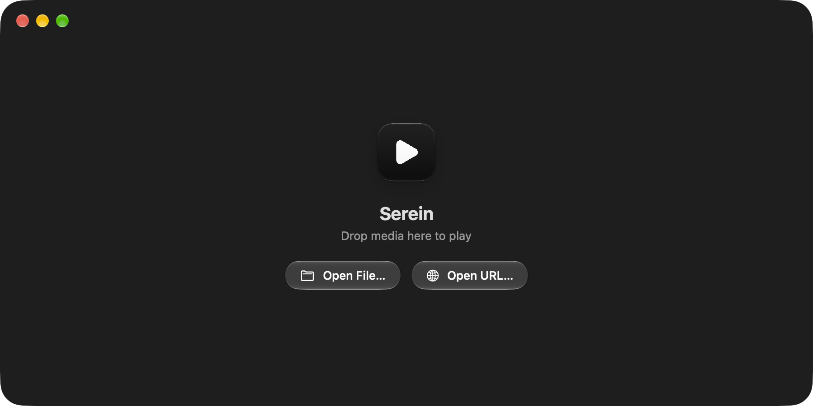

<p align="center">
  
</p>

<h1 align="center">Kino</h1>

<p align="center">
  <strong>The Modern QuickTime Player Successor with Next-Gen Codec Support</strong><br/>
  Native, lightweight, hardware-accelerated media player & coordinator built with SwiftUI, AppKit, and AVFoundation for Apple Silicon macOS.
</p>

<p align="center">
  <a href="https://github.com/passs0/Kino/releases/latest"></a>
  
  
  
  <a href="LICENSE"></a>
</p>

<p align="center">
  
</p>

---

> [!NOTE]
> **AI-Generated Project Disclosure**
> **Kino** (including its architecture, VideoToolbox zero-copy HLS pipeline, custom MediaAccessibility subtitle renderer, and Apple squircle design) is an **AI-generated project** created with **Antigravity** (Google DeepMind).

---

## ✨ Why Kino?

For decades, **QuickTime Player** has set the standard for macOS media playback: instant startup, ultra-efficient hardware decoding with near-zero battery drain, smooth timeline scrubbing, and pure Apple Human Interface design.

**The catch?** QuickTime refuses to open `.mkv`, `.webm`, `.opus`, or web streams, and rejects modern subtitles (`.ass`, `.srt`, web captions). To watch these files, Mac users often have to rely on external tools that may not integrate natively with macOS design standards, rely on heavier software decoders, or feature complex multi-window interfaces.

**Kino is the modern successor:**
- **QuickTime Aesthetics & Efficiency:** Native Cocoa chrome, fluid animations, and 0% CPU consumption on standard formats.
- **Universal Codec & Container Support:** Plays `.mkv`, `.webm`, `.avi`, `.ts`, `.mp4`, `.mov`, `.flac`, `.alac`, `.thd`, `.mlp`, VP9, AV1, Opus, and Dolby TrueHD seamlessly.
- **Version-aware window styling:** Supports macOS 13 and later. macOS 26 and later use Liquid Glass controls; earlier versions use native material fallbacks. The four dynamic icon appearances are shown by macOS 26 and later, with a static icon fallback on earlier systems.
- **Pure Apple Native Video Enhancement:** Built-in Apple MetalFX Spatial Super-Resolution and CoreImage GPU filters with zero file bloat.
- **Multi-Channel Surround Audio:** Preserves discrete 5.1 and 7.1 audio tracks and Dolby Atmos Spatial Audio pass-through.
- **Zero-Friction In-App Engine Setup:** Automatically manages helper engines with 1 click in user space—no Terminal commands, no Homebrew, and no `sudo` required!

---

## 🚀 Features

### 1. Intelligent Playback Strategy Matrix
Kino actively evaluates container formats, audio streams, and video codecs before dynamically selecting the optimal playback path:

| Strategy | When Applied | Impact & Performance |
| :--- | :--- | :--- |
| **Direct Native** | Supported container (`.mp4`, `.mov`, `.m4v`) + native codecs (H.264, HEVC, ProRes, AAC) | **0% CPU Overhead**, instant hardware decode via AVPlayer (`< 5ms` startup). |
| **Zero-Copy Stream Remux** | Incompatible container (`.mkv`, `.webm`) with native video streams | Repackages container on-the-fly to local HLS in **`< 100ms`** with **zero video re-encoding**. |
| **Audio Transcode** | Native video (H.264/HEVC) paired with incompatible audio (DTS, Opus, TrueHD) | Bit-for-bit passthrough for video; audio transcoded in real time (`>30×` speed) to high-fidelity AAC. |
| **Hardware VideoToolbox** | Incompatible video codecs (VP9, VP8, AV1, MPEG-2) | Real-time Apple Silicon VideoToolbox GPU encoding with 0% dropped frames. |
| **Online Stream Bridge** | Web streaming links & video platforms | Authenticated piped `yt-dlp` ➔ `FFmpeg` pipeline bypassing 403 Forbidden CDN blocks while preserving original audio. |

### 2. Pure Apple Native Video Enhancement & Upscaling Suite
Kino includes a zero-bloat GPU video enhancement suite integrated directly via hardware-accelerated CoreAnimation layer filtering (`AVPlayerLayer.filters`):
- **Apple MetalFX: Spatial Super-Resolution:** Integrates Apple's first-party `MetalFX.framework` (`MTLFXSpatialScaler`), engineered specifically for Apple Silicon GPUs to reconstruct crisp high-frequency detail.
- **Luminance Detail Enhancer (`CISharpenLuminance`):** Isolates the luma channel to sharpen micro-textures and fine details without amplifying chroma noise.
- **Edge & Outline Enhancer (`CIUnsharpMask`):** High-contrast edge restoration tuned with a tight radius for animation, cel-shading, cartoons, line art, and interface text.
- **Noise & Grain Suppression (`CINoiseReduction`):** Spatial bilateral noise reduction smoothing macroblocking and sensor grain while keeping edge boundaries razor-sharp.
- **Cinematic Contrast & Color:** Compound dynamic range filter combining luminance clarity with rich contrast and color vibrance.
- **Zero CPU & Zero Bundle Bloat:** Filters run directly inside the GPU display compositor at the native display refresh rate (including 120Hz ProMotion). The entire application bundle remains ultra-compact at just **3.3 MB**.

### 3. Discrete Multi-Channel Surround Sound & Dolby Atmos
- **Discrete 5.1 & 7.1 Preservation:** Retains discrete multi-channel surround tracks at high studio bitrates (384–640 kbps) without downmixing to stereo.
- **Dolby Atmos & Spatial Audio:** Passes E-AC-3 JOC directly to macOS AudioToolbox, enabling native Spatial Audio with dynamic head tracking on AirPods and built-in Mac speaker arrays.
- **Dolby TrueHD & MLP Lossless Decoding:** Dynamic container demuxing and high-bandwidth pipeline preserving high-resolution multi-channel audio tracks.
- **Multi-Track Audio Switching:** Effortlessly switch between original audio tracks, commentary, and localized dubs from the Options menu (`...`).

### 4. Native OpenSubtitles.com Integration & Subtitle Engine
Kino treats subtitles as a first-class citizen with both local media intelligence and global online database integration:
- **Native OpenSubtitles.com Integration (`⌥⌘S`):** Search, browse, and download subtitles across 100+ languages directly inside Kino with a single click. No browser trips or manual `.srt` file juggling required.
- **64-bit Checksum Exact Frame Sync (`MovieHash`):** Computes the official 64-bit OpenSubtitles checksum on local media files upon launch. Subtitles matching the exact file release and framerate are prominently badged (`⭐️ Exact Match`), guaranteeing 100% synchronized timing with zero audio/caption drift.
- **Sample-Accurate A/V Clock Locking:** Continuous `aresample=async=1000:first_pts=0` audio clock resampling locks audio presentation timestamps directly to video PTS, eliminating initial audio delay, container clock drift, and seek offset gaps.
- **Keyframe-Aligned Stream Seeking:** Fast demuxing automatically aligns stream seek offsets to exact video keyframe boundaries, ensuring video, audio, timeline scrubbers, and subtitles remain in 100% lockstep without any lead or lag.
- **Native Subtitle Delay Controls (`G` / `H`):** Adjust subtitle timing in real time by $\pm 0.1$s (`G` / `H`), $\pm 0.5$s (`⇧G` / `⇧H`), or reset to 0.0s (`⌥G`), with native Apple HUD feedback and controls in Settings (`⌘,`) and the Subtitles menu.
- **Simultaneous Multi-Cue Rendering:** Accurately renders multiple speakers and dialogue lines speaking simultaneously without dropping concurrent cues or duplicating lines.
- **Dual Subtitle Placement Modes (`Z`):** Toggle between **In Letterbox Bar (Display Height)**—positioning captions cleanly inside the black cinema bars below the picture—and **Inside Video (Media Height)**.
- **Smart Title Query Cleaner:** Intelligently cleans scene tags (e.g. `The.Matrix.1999.2160p.UHD.BluRay.x265-TERMINAL` $\rightarrow$ `The Matrix 1999`) to retrieve the highest-rated community releases.
- **Account & VIP Quota Management:** Built-in account login for registered OpenSubtitles users (granting 20 free downloads/24h) and custom API key support, with automatic browser fallback links.
- **System-Wide Accessibility Consistency:** Subtitles dynamically adapt to your preferences in **System Settings ➔ Accessibility ➔ Captions** (e.g. *Transparent Background*, *Classic*, *Outline Text*, or *Large Text*).
- **Responsive Subtitle Scaling:** Caption font size, padding, and line height dynamically scale with viewport height (`18 pt` to `48 pt`) when entering full screen.
- **Automatic Sidecar Subtitle & Lyric Discovery:** Automatically detects `.srt`, `.vtt`, `.ass`, `.ssa`, `.sub`, and `.lrc` files located alongside media or in `Subs/` and `Subtitles/` subdirectories.
- **Drag-and-Drop Subtitle Attachment:** Drop any external subtitle or lyric file directly onto the player window to immediately switch to that track without stopping the video.
- **Remote Progressive Range Demuxing:** High-efficiency sparse demuxing for massive remote cloud containers (e.g. 15GB+ Matroska streams) with multi-byte UTF-8 split protection.
- **Multi-Encoding Auto-Detection:** Seamlessly decodes UTF-8 (with or without BOM), UTF-16LE/BE, GB18030/GBK, and Windows CP1252 subtitles.
- **Smart ASS/SSA Sanitization:** Automatically strips cluttered custom font/color overrides from anime and community subtitles while preserving semantic screen positioning (top, bottom, and center placement).
- **Embedded Subtitle Extraction:** Automatically extracts container-embedded tracks (`mov_text`, `srt`, `ass`, `webvtt`) on-the-fly.

### 5. Modern QuickTime Design & Window Mechanics
- **Unified QuickTime Floating HUD Bar:** Apple's iconic single floating HUD capsule (`.ultraThinMaterial`) anchored at the bottom of the video, leaving the entire video canvas 100% clean and unobstructed across both windowed and full-screen modes.
- **Zero-Lag Full Screen Space Switching:** Orders the key window front and activates the application before animating into full screen, ensuring macOS immediately switches desktop Spaces to the video rather than stranding the user on the previous desktop.
- **Unconstrained 2D Resizing with Fluid Letterboxing:** Smooth, free-form 2D window resizing in all directions without aspect ratio lockups or `NaN` coordinate errors, automatically framing the media with clean cinema letterboxing bars.
- **Online Stream Title Extraction:** YouTube, Bilibili, and web stream titles are automatically parsed and displayed in the native titlebar instead of generic host URLs.
- **Adaptive QuickTime Light & Dark Appearance:** Keeps the video canvas focused in cinema dark during active playback while seamlessly adapting window chrome and menus to the system appearance during idle state.
- **San Francisco Tabular Digits (`tnum`):** QuickTime-native SF Pro medium typography with tabular digits prevents horizontal glyph wobble while scrubbing or playing.
- **Titlebar Document Proxy Icon & Single-Axis Alignment:** Integrated macOS document proxy icon (`window.representedURL`) in the titlebar, aligned to the exact horizontal center axis of the 26pt inset traffic lights. When mouse is inactive for 2.5s, the titlebar, traffic lights, and floating HUD bar smoothly fade out in unison for a borderless cinema canvas.
- **Apple First-Party Controls & Recent Items:** Uses Apple's `.borderedProminent` and `.bordered` controls, `NSDocumentController` Open Recent integration, AppKit `NSSlider`, and transient center play/pause feedback.
- **Centered Floating Modal Inspector (`⌘I`):** A centered floating diagnostic block presenting live playback strategy, active upscaling pipeline, audio codec channels, and stream probe metadata. Dismiss with `Esc` or a click outside.

### 6. macOS Control Center & Now Playing Integration
- **System-Wide Media Hub:** Seamlessly integrates with Apple's `MediaPlayer` framework (`MPNowPlayingInfoCenter` and `MPRemoteCommandCenter`).
- **Live Metadata & Poster Artwork:** Broadcasts real-time video title, creator/channel, duration, elapsed position, and video thumbnail/poster frames to the macOS menu bar Control Center widget, Lock Screen, and Touch Bar.
- **Hardware Media Key & Remote Commands:** Full native support for keyboard Play/Pause, Touch Bar scrubbing, headphone remotes, and `±5s` skip controls.

### 7. Unified Audio Mode & Clean Presentation
- **Unified Player Architecture:** Audio mode and Video mode share the same refined control layout, shortcuts, and interaction model.
- **Responsive Music Canvas:** Album artwork scales with the window, while track details and playback controls stay within the available height. A subtle, blurred wash from the cover art adds atmosphere while keeping text and controls legible.
- **Lossless Audio Engine (0% CPU):** Direct hardware playback for `.flac`, `.alac`, `.m4a`, `.mp3`, `.wav`, and `.aiff`.
- **Pure Swift Album Art Parser:** Extracts high-resolution embedded cover artwork directly from FLAC `METADATA_BLOCK_PICTURE` headers, MP3 ID3 APIC frames, and M4A `covr` atoms in `< 1ms` with zero subprocesses.
- **Desktop Always-On-Top Pinning (`⌥⌘P`):** Float the player above code editors, browsers, and terminal windows with a single click on the pin button (`📌`).

---

## ⚡️ Zero-Friction Setup: No Terminal Required

Unlike traditional players that demand manual command-line installations, Kino keeps the core application download ultra-compact (**~3.3 MB app, ~2.7 MB .dmg**) and provides an **automated in-app engine installer**:

1. **Automatic Detection:** If you already have Homebrew (`brew install ffmpeg yt-dlp`), Kino detects and uses them immediately with zero configuration.
2. **1-Click In-App Download:** On fresh Macs without Homebrew, Kino prompts you with a clean native setup sheet (`⌘,`) and downloads managed static binaries directly into `~/Library/Application Support/Kino/bin/`.
3. **Preserves Apple Code Signatures:** By keeping helper engines in user Application Support, Kino never breaks its Gatekeeper code signatures and enables seamless background updates via `yt-dlp -U`.

---

## ⌨️ Native Controls & Keyboard Shortcuts

| Shortcut | Action |
| :--- | :--- |
| **`Space`** | Play / Pause |
| **`←` (Left Arrow)** | Step Backward (`5s`) |
| **`→` (Right Arrow)** | Step Forward (`5s`) |
| **`,` / `.`** | Step Backward / Forward **1 Frame** |
| **`⌘[` / `⌘]`** | Previous / Next **Chapter** |
| **`⌥⌘L`** | Toggle **Loop** Playback |
| **`+` / `=`** | Volume Up (`+10%`) |
| **`-`** | Volume Down (`-10%`) |
| **`M`** | Mute / Unmute |
| **`C`** | Toggle Video Aspect Ratio: **Fit to Screen (Letterbox)** vs. **Fill Screen** |
| **`Z`** | Toggle Subtitle Placement: **In Letterbox Bar** vs. **Inside Video** |
| **`G`** | Subtitle Delay **-0.1s** (Subtitles appear earlier) |
| **`H`** | Subtitle Delay **+0.1s** (Subtitles appear later) |
| **`⇧G`** | Subtitle Delay **-0.5s** |
| **`⇧H`** | Subtitle Delay **+0.5s** |
| **`⌥G`** | Reset Subtitle Delay to **0.0s** |
| **`⌥⌘S`** | **Search Subtitles Online…** (OpenSubtitles.com REST API v1) |
| **`⌃⌘F`** | Toggle Full Screen (Instant Space Switch) |
| **`⌘I`** | Toggle Centered Media Statistics & Technical Inspector HUD |
| **`⌥⌘M`** | Toggle Compact Liquid Glass MiniPlayer (Music Mode) |
| **`⌥⌘P`** | Toggle Always-on-Top Floating Window |
| **`Esc`** | Dismiss Media Statistics HUD or active modal |
| **`⌘,`** | Media Engines & Codecs Setup Sheet |
| **`⌘O`** | Open Local Media File |
| **`⌘U`** | Open Online Streaming URL |
| **`⌘W`** | Close Window |

---

## 🛠️ Building & Installing

### Option 1: Direct Download (Pre-built macOS Disk Image)
1. Download **[`Kino-v1.1.0.dmg`](https://github.com/passs0/Kino/releases/latest)** from [GitHub Releases](https://github.com/passs0/Kino/releases).
2. Open the downloaded `.dmg` and drag **`Kino.app`** directly into the **`Applications`** folder shortcut.
3. If macOS Gatekeeper flags the downloaded binary on first launch (ad-hoc signed):
   - Right-click `Kino.app` ➔ **Open**, or run:
     ```zsh
     xattr -cr /Applications/Kino.app
     ```
4. Open `Kino.app` and press `⌘O` to open any file or `⌘U` for streaming links!

### Option 2: Build from Source
```zsh
git clone https://github.com/passs0/Kino.git
cd kino
./build_app.sh
```
> [!NOTE]
> `./build_app.sh` automatically compiles, ad-hoc code-signs, and cleanly installs `Kino.app` directly into `/Applications/`. You can also run `make dmg` to package a release disk image.

---

## 🗺️ Roadmap

### Core Playback & Codecs (v1.0.0 Complete)
- [x] Native AVFoundation + VideoToolbox zero-copy hybrid engine
- [x] In-app automated media engine downloader & updater (zero Terminal required)
- [x] Universal container support (`.mkv`, `.webm`, `.avi`, `.ts`, `.mp4`, `.mov`, `.flac`, `.alac`, `.thd`, `.mlp`)
- [x] High-speed visionOS multi-variant HLS streaming with automated CDN fallback
- [x] Variable speed playback with CoreAudio pitch correction (`0.5×`–`2.0×`)
- [x] Loop playback (`⌥⌘L`), exact frame-by-frame stepping (`,` / `.`), and embedded chapter navigation (`⌘[` / `⌘]`)
- [x] Native Picture-in-Picture (`AVPictureInPictureController`) with live subtitle overlay
- [x] Display & system idle sleep prevention during active playback

### Apple Design & Interface (v1.0.0 Complete)
- [x] macOS 26 continuous squircle corner radius (26pt) support
- [x] San Francisco tabular digits (`tnum` / `.monospacedDigit()`) for jitter-free scrubbing
- [x] Optical traffic light positioning (26pt inset) with single-axis titlebar alignment
- [x] Apple Liquid Glass design & dynamic System Settings tint adjustment (`NSGlassTintAmount`)
- [x] Apple AppKit native `NSSlider` controls for volume & timeline scrubbing
- [x] QuickTime optical liquid glass thumb with submerged core progress & specular edge lighting
- [x] Unified Video & Audio player architecture with single cohesive control layout
- [x] Clean Audio Mode with high-resolution album artwork, artist, and album typography
- [x] Minimalist Welcome Screen with floating squircle app icon & direct open actions
- [x] Centered Media Statistics Technical Inspector (`⌘I`) with dark glass scrim
- [x] macOS Control Center & Now Playing widget integration (`MPNowPlayingInfoCenter` & `MPRemoteCommandCenter`)
- [x] Unconstrained 2D window resizing with cinema letterbox framing & aspect ratio protection
- [x] Instant full-screen desktop Space switching without focus strand (`⌃⌘F`)
- [x] Automatic online stream video title parsing (YouTube, Bilibili, etc.)

### Audio & Subtitles (v1.0.0 Complete)
- [x] Native OpenSubtitles.com online subtitle search, multi-language filter & 1-click download (`⌥⌘S`)
- [x] 64-bit `MovieHash` checksum calculation for exact frame-level timing synchronization
- [x] Dual subtitle placement: In Letterbox Bar (Display Height) vs Inside Video (Media Height) (`Z`)
- [x] Apple MetalFX Spatial Super-Resolution & CoreImage GPU video enhancement suite
- [x] Multi-channel surround sound preservation (discrete 5.1 & 7.1 tracks & Dolby Atmos)
- [x] Dolby TrueHD & MLP lossless multi-channel container demuxing & high-bitrate streaming pipeline
- [x] macOS Accessibility caption rendering (`MACaptionAppearance`) with responsive full-screen scaling
- [x] Automatic sidecar subtitle & lyric discovery (`.srt`, `.vtt`, `.ass`, `.ssa`, `.sub`, `.lrc`)
- [x] Drag-and-drop subtitle loading without stopping active video playback
- [x] Remote MKV streaming progressive subtitle demuxing with sparse range tracking
- [x] Multi-encoding subtitle decoder (UTF-8 with BOM, UTF-16, GB18030, CP1252)

See the [roadmap](ROADMAP.md) for future ideas under consideration.

---

## 📄 License

Released under the [MIT License](LICENSE).

See the [release notes](RELEASE_NOTES.md) and [roadmap](ROADMAP.md).
