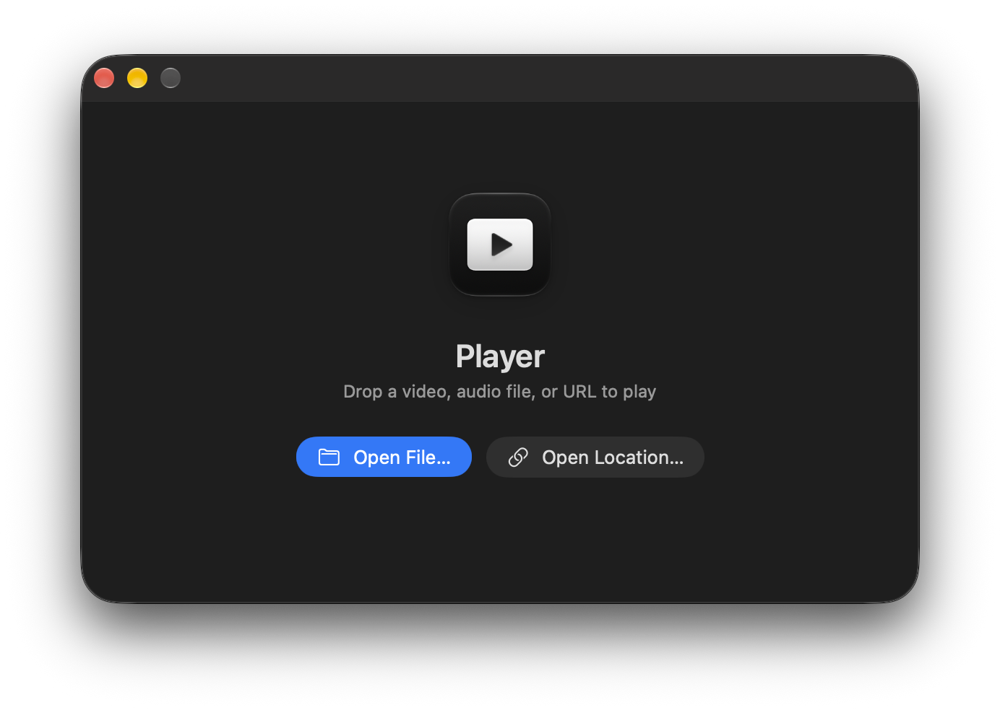

<p align="center">
  
</p>

<h1 align="center">Player</h1>

<p align="center">
  A lightweight macOS media player with QuickTime ergonomics and support for MKV, WebM, AV1, VP9, FLAC, and web streams.
</p>

<p align="center">
  <a href="https://github.com/passs0/Player/releases/latest"></a>
  
  <a href="LICENSE"></a>
</p>

<p align="center">
  
</p>

---

## What it does

- **Zero-overhead native path:** Plays `.mp4` and `.mov` directly with `AVPlayer` at ~0% CPU, and remuxes `.mkv`/`.webm` to local HLS in `< 100ms` without re-encoding video.
- **Hardware transcode & streams:** Uses Apple VideoToolbox for VP9/AV1 and bridges web URLs via `yt-dlp` + `ffmpeg` (auto-managed in user space with no Homebrew required).
- **CoreImage GPU filters:** Real-time GPU sharpening, contrast enhancement, and noise reduction.
- **Subtitles & audio:** Built-in OpenSubtitles.com search (`⌥⌘S`) with `MovieHash` matching, delay controls (`G` / `H`), sidecar `.srt`/`.ass`/`.vtt` discovery, 5.1/7.1 surround, Dolby Atmos, and lossless `.flac`/`.alac` playback with cover art.

## How it compares

| | Player | QuickTime Player | IINA | VLC | Infuse |
| :--- | :---: | :---: | :---: | :---: | :---: |
| **App size** | ~3 MB | Built-in | ~140 MB | ~140 MB | ~80 MB |
| **Price / License** | Free (MIT) | Free | Free (GPL) | Free (GPL) | Freemium / Sub |
| **Native `AVPlayer` path** | Yes | Yes | No (`mpv`) | No (`libvlc`) | Custom Metal |
| **MKV / WebM / VP9 / AV1** | Yes (via `ffmpeg`) | No | Yes | Yes | Yes |
| **Web URLs (`yt-dlp`)** | Built-in | No | Built-in | Limited | No |
| **CoreImage GPU sharpening** | Yes | No | Custom shaders | Basic | Custom |
| **OpenSubtitles search** | Built-in (`MovieHash`) | No | Plugin / built-in | Extension | Built-in |
| **SMB / Plex / Jellyfin library** | No | No | No | Yes | Yes |
| **Playlists & video editing** | No | Trim / Split | Playlists | Playlists | Library |
| **Intel Mac support** | No (Apple Silicon) | Yes | Yes | Yes | Yes |

**Where Player falls short:**
- **No media library or network shares:** Unlike Infuse or VLC, Player doesn't browse SMB/NFS shares, Plex, or Jellyfin libraries—it's a single-file/URL player.
- **No playlists or trim/export tools:** QuickTime handles quick trimming and screen recording; IINA and VLC support playlists and deeper `mpv`/shader scripting.
- **Depends on `ffmpeg`/`yt-dlp` for non-native formats:** `.mkv`, VP9, AV1, and web streams require Player's user-space helper download on first use, and seeking on heavy software-decoded streams isn't as instant as `mpv` in IINA.
- **Apple Silicon & macOS 13+ only:** No Intel Mac, iOS, or tvOS builds.

## Install

Download **`Player-v1.2.2.dmg`** from [Releases](https://github.com/passs0/Player/releases/latest) and drag `Player.app` to `/Applications`.

If Gatekeeper blocks the first launch:
```zsh
xattr -cr /Applications/Player.app
```

Or build from source:
```zsh
git clone https://github.com/passs0/Player.git && cd Player
./build_app.sh
cp -R build/Player.app /Applications/
```

## Credits

Built with [Google Antigravity](https://antigravity.google) — 100% AI-written code and UI, steered and tested by hand.

## License

[MIT](LICENSE)
